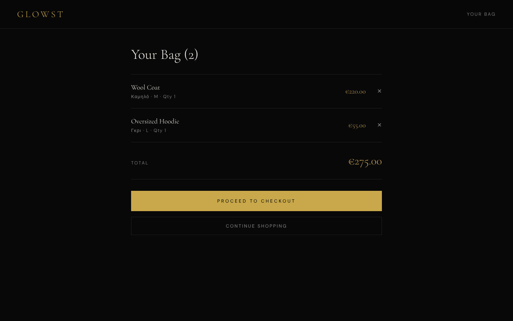
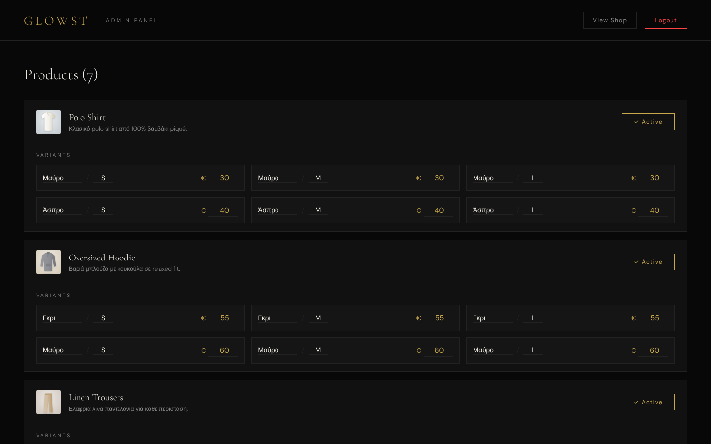

# 🌟 Glowst E-shop - Full Stack Application

A complete and modern e-commerce application built with **FastAPI** on the Backend and **React** on the Frontend. The application features a comprehensive management system (Admin Panel), dynamic product searching, and an integrated checkout flow powered by **Stripe**.


| Collection | Product |
|---|---|
|  |  |
| **Bag** | **Admin panel** |
|  |  |

<sub>The product pictures in these screenshots are placeholder illustrations; the seeded catalogue uses photos from Unsplash.</sub>

---

## 🚀 Technologies Used

### Backend (API)
* **Python 3.13+** - The core programming language of the backend.
* **FastAPI** - High-performance framework for building the REST API.
* **SQLAlchemy** - ORM for secure and seamless database communication.
* **SQLite** - Lightweight and reliable SQL database for storing products, variants, and administrators.
* **Bcrypt & JWT (JSON Web Tokens)** - Modern and secure mechanisms for password hashing (Python 3.13 compatible) and administrator authentication.
* **Uvicorn** - Lightning-fast ASGI server to run the application.
* **Stripe SDK** - Official library for processing payments and creating Checkout Sessions.

### Frontend
* **React.js** - Component-based library for the store's User Interface.
* **Vite** - Development server and production build.
* **React Router** and **Axios** - Page routing and API calls.

---

## 🛠️ Features

* **Secure Admin Panel:** Admin authentication flow utilizing encrypted passwords (Bcrypt) and protected routes via JWT tokens.
* **Complex Product Management:** Support for products with multiple variations (Variants) including specific colors, sizes, and dedicated stock limits per variant.
* **Dynamic Search & Filter:** Live product searching from the Frontend based on name or description, optimized with database eager loading (`joinedload`) to prevent N+1 query issues.
* **Stripe Payments:** Full integration of Stripe Checkout for secure credit/debit card transactions.
* **Stability & Logging:** Global exception handling middleware to catch unforeseen server errors and custom middleware for response time tracking.

---

## 💻 Local Setup

### 1. Clone the Repository
```bash
git clone https://github.com/Nikpar005/glowst-eshop.git
cd glowst-eshop/backend

py -3.13 -m pip install -r requirements.txt

py -3.13 -m uvicorn main:app --reload

The API will be up and running at: http://127.0.0.1:8000

You can view the interactive API documentation (Swagger UI) at: http://127.0.0.1:8000/docs

🔒 Security & Environment
For security purposes, sensitive credentials (such as the JWT SECRET_KEY and the Stripe API Key) are protected locally and excluded from version control via the .gitignore file. In a production environment, these are injected securely using Environment Variables.
